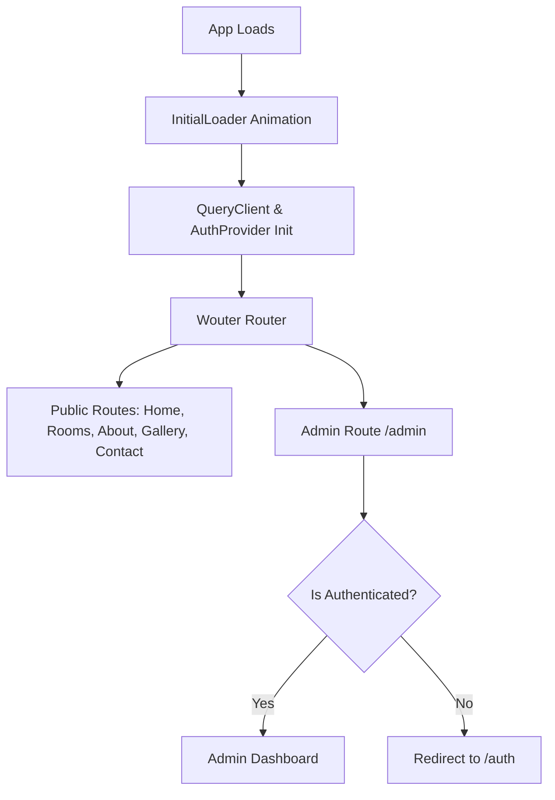

# Kora Hotel Suites — Complete System Walkthrough

> **Scope**: This document covers the entire full-stack architecture of the Kora Hotel Suites (Kora Apartment) project, including the public-facing website, the admin dashboard, the media processing pipeline, the database layer, and the backend Express/Drizzle infrastructure.

---

## Table of Contents

1. [Client-Side Architecture & Responsive Layout](#1-client-side-architecture--responsive-layout)
2. [Database Schema & Data Layer](#2-database-schema--data-layer)
3. [Dynamic Room Reordering System](#3-dynamic-room-reordering-system)
4. [503 Error Prevention & Process Lifecycle](#4-503-error-prevention--process-lifecycle)
5. [Authentication & Session Management](#5-authentication--session-management)
6. [Backend API & Image Processing](#6-backend-api--image-processing)
7. [Admin Dashboard (CMS)](#7-admin-dashboard-cms)
8. [Automated Email System](#8-automated-email-system)
9. [Deployment & cPanel Hosting](#9-deployment--cpanel-hosting)

---

## 1. Client-Side Architecture & Responsive Layout

**Files**: `client/src/App.tsx`, `client/src/pages/Rooms.tsx`, `client/src/components/RoomCard.tsx`

### Overview
Kora Hotel Suites uses a modern React 18 single-page application (SPA) model powered by Vite, **Wouter** for routing, and **Framer Motion** for animations.



### 12-Column Responsive Suite Cards
On the Suites listing page (`/rooms`), suite cards use a balanced 12-column responsive layout:
* **Image Column (`lg:col-span-5`):** Constrained with `min-h-[260px] lg:min-h-[380px] max-h-[500px]` and `aspect-[16/10]` / `aspect-[16/9]`, preventing photos from ballooning to 800px+ tall. Includes an automated image slideshow with pagination dots and navigation controls.
* **Details Column (`lg:col-span-7`):** Provides horizontal space for suite titles, "Starting from $X / Night" badges, full room descriptions, an amenities icon grid, and quick info pills (Size, Bedrooms, Capacity, Bed Type).
* **Viewport Optimization:** At standard 100% browser zoom, the entire card fits inside normal screen viewports without requiring manual browser zoom-out.

---

## 2. Database Schema & Data Layer

**File**: `shared/schema.ts`

### Schema Architecture
The database layer uses **Drizzle ORM** with Zod schema generation (`drizzle-zod`):

| Table | Fields & Capabilities |
|---|---|
| `rooms` | `id`, `name`, `slug`, `description`, `price`, `capacity`, `size`, `bed_type`, `image_url`, `youtube_url`, `amenities` (array), `sort_order` (integer) |
| `room_images` | `id`, `room_id`, `image_url`, `sort_order` (slideshow gallery for individual suites) |
| `gallery_images` | `id`, `image_url`, `caption`, `sort_order`, `created_at` (main hotel photo gallery) |
| `bookings` | `id`, `room_id`, `guest_name`, `guest_email`, `check_in`, `check_out`, `adults`, `children`, `status`, `created_at` |
| `contacts` | `id`, `name`, `email`, `subject`, `message`, `created_at` (guest contact form inquiries) |
| `site_settings` | `key`, `value`, `label`, `type` (CMS dynamic config: hero titles, colors, images, SMTP, maps) |
| `users` | `id`, `username`, `password` (hashed via scrypt), `role`, `created_at` |

---

## 3. Dynamic Room Reordering System

**Files**: `shared/schema.ts`, `server/storage.ts`, `client/src/pages/admin-page.tsx`

### How It Works
1. **Database Column:** Each room has a `sort_order` integer field (default `0`).
2. **Query Sorting:** `storage.getRooms()` retrieves rooms ordered by:
   ```ts
   db.select().from(rooms).orderBy(asc(rooms.sortOrder), asc(rooms.id));
   ```
3. **Admin Management:**
   - **One-Click Up/Down Arrows:** Admins can click ▲ or ▼ directly on any row in the admin Rooms table to swap positions with adjacent suites.
   - **Manual Order Input:** In the Edit Room dialog, admins can set the explicit `Display Order` integer (e.g. `1`, `2`, `3`, `4`).
4. **Instant Updates:** Updates use `PATCH /api/rooms/:id`, invalidating the React Query cache so the Home and Suites pages update immediately.

---

## 4. 503 Error Prevention & Process Lifecycle

**Files**: `server/index.ts`, `server/db.ts`

### Architectural Fix
To support cPanel's Passenger application manager without dropping connections or crashing on idle restarts:
1. **Signal Interception:** Node.js listens for `SIGTERM` and `SIGINT` from the OS.
2. **Clean Disconnect:** `httpServer.close()` stops receiving new traffic; `closeDb()` closes the database client and unlinks `postmaster.pid`.
3. **Boot-Time Self-Healing:** On boot, if `db-storage/postmaster.pid` exists from a previous ungraceful server termination, it is automatically unlinked before PGlite initialization.

---

## 5. Authentication & Session Management

**File**: `server/auth.ts`

* **Strategy:** Passport.js Local Strategy using `scrypt` password hashing.
* **Session Storage:** Secure HTTP-only cookies managed via `express-session` with session stores.
* **Protected Routes:** `isAuthenticated` middleware protects `/api/rooms/*` (write operations), `/api/gallery/*`, `/api/settings/*`, and `/api/bookings/*`.

---

## 6. Backend API & Image Processing

**File**: `server/routes.ts`

* **Sharp Image Optimization:** Admin image uploads are intercepted via `multer`, auto-rotated by EXIF, scaled to a maximum of 1920x1080 (preserving aspect ratio), and converted to WebP at 80% quality. Original raw files are cleaned up immediately.
* **Cache Busting Headers:** All JSON responses include explicit `Cache-Control: no-store, no-cache, must-revalidate` headers to ensure admin edits reflect immediately.

---

## 7. Admin Dashboard (CMS)

**File**: `client/src/pages/admin-page.tsx`

The admin dashboard provides complete control over hotel operations:
* **Bookings:** Review, confirm, or decline guest reservation requests.
* **Rooms:** Add, edit, delete, and reorder suites. Manage prices, capacities, bedrooms, bed configurations, and custom bulleted amenities.
* **Room Images:** Manage multi-image carousel slideshows for each suite.
* **Gallery:** Add photos with captions to the public gallery, reorder images, or remove outdated photos.
* **Inquiries:** Read and manage contact form submissions.
* **Site Settings:** Edit hero banners, subtitle text, gold accents, contact information, and SMTP mail credentials.

---

## 8. Automated Email System

**File**: `server/email.ts`

Uses `nodemailer` with dynamic credentials configured in Site Settings:
* **Booking Inquiries:** Sends an instant booking confirmation to the guest and a notification email with reservation details to the hotel administrator.
* **Contact Forms:** Forwards guest messages straight to the hotel's inbox.

---

## 9. Deployment & cPanel Hosting

**Files**: `CPANEL_DEPLOYMENT.md`, `cpanel_update_final.zip`

The build pipeline bundles the application into a single pre-built deployment package:
* `npm run build` generates the production server bundle `dist/index.js` and frontend bundle `dist/public/`.
* `cpanel_update_final.zip` is created with all runtime code, migrations, and schema definitions.
* Safe deployment: Uploading and extracting the zip file never affects existing database data in `db-storage/`.
